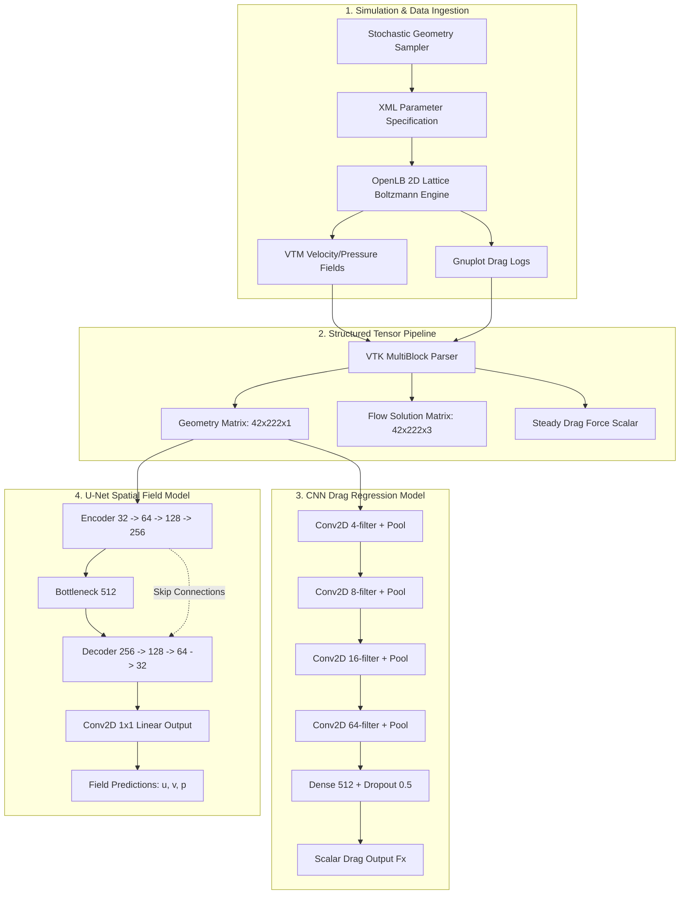
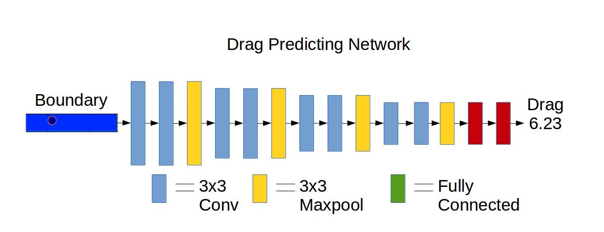
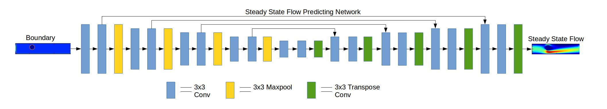
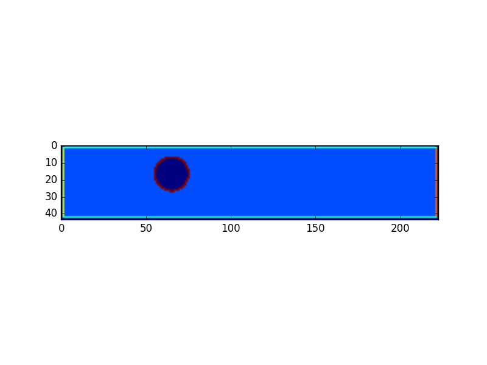
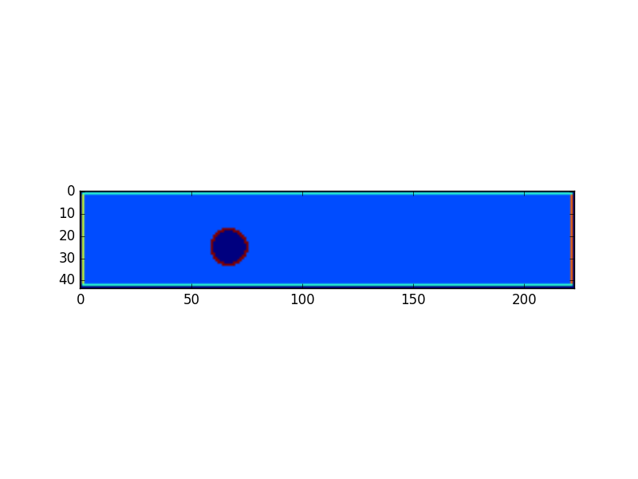
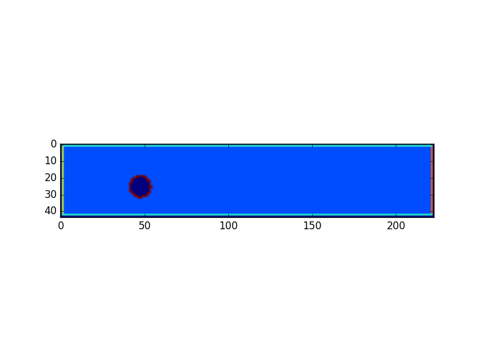
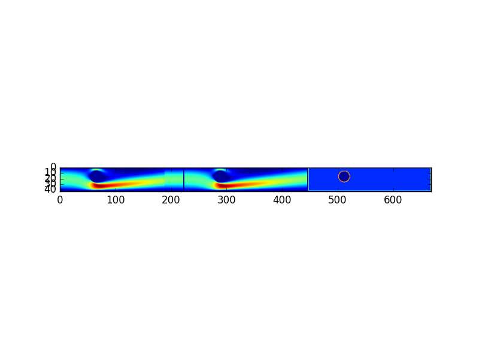
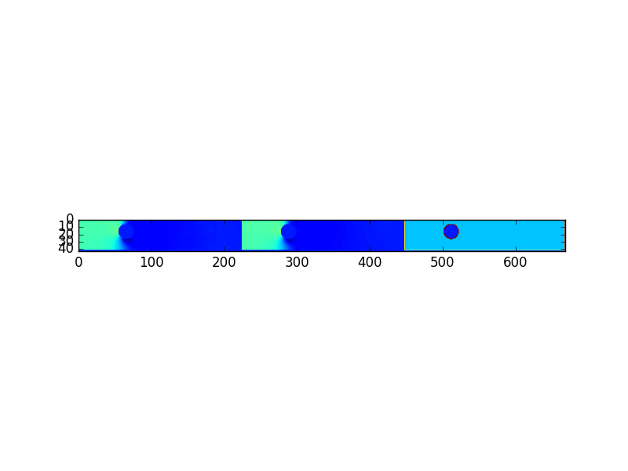
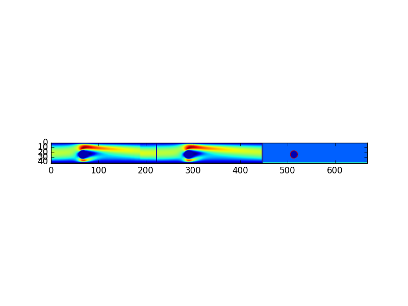
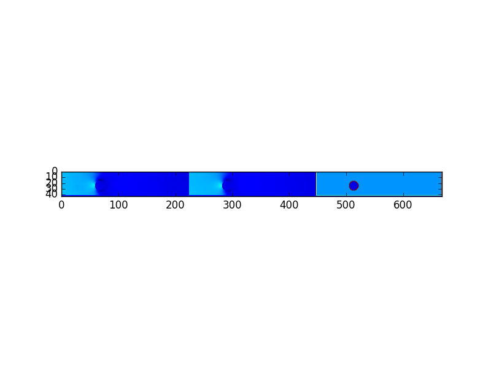

<div align="center">

# 🌊 CFD Simulation & Neural Network Surrogate Modeling Pipeline

**High-Performance Computational Fluid Dynamics (CFD) Solution Field & Aerodynamic Drag Estimation via Deep Convolutional Surrogates**

[](https://www.python.org/)
[](https://www.tensorflow.org/)
[](https://keras.io/)
[](https://vtk.org/)
[](https://www.openlb.net/)
[](LICENSE)
[](tests/)
[](https://github.com/Aditya001-max)

</div>

---

## 📌 Executive Summary

Traditional Computational Fluid Dynamics (CFD) simulations—such as those utilizing high-fidelity Lattice Boltzmann Methods (LBM) or Navier-Stokes discretizations—are computationally demanding and time-prohibitive for real-time aerodynamic optimization and multi-query design loops. 

This repository implements an end-to-end **Deep Learning Surrogate Modeling Pipeline** that replaces expensive numerical solves with instantaneous neural network inference. By modeling a curated CFD dataset of **2,000 randomized cylindrical flow geometries**, the pipeline structures raw geometries and VTK multiblock solution fields into high-dimensional supervised learning pairs. It introduces two specialized neural architectures: a **4-stage deep Convolutional Neural Network (CNN)** for scalar steady-state drag force regression, and an **Encoder-Decoder U-Net with skip connections** for full spatial field reconstruction of 2D velocity vectors $(u, v)$ and static pressure $(p)$. Optimized using Adam and MSE loss over 100 epochs, the surrogate achieves a **0.72 test set MSE for steady-state drag prediction**, slashing evaluation latency from minutes to milliseconds.

---

## 🏛️ System Architecture & Data Pipeline

```
 +-----------------------------------------------------------------------------------+
 |                             CFD & SURROGATE PIPELINE                              |
 +-----------------------------------------------------------------------------------+
                                          |
  [1] GEOMETRY STOCHASTICS                v
  +--------------------+         +------------------+
  |  Randomized Radius | ------> |  XML Parameter   |
  |  & (X, Y) Position |         |  Manifests (2000)|
  +--------------------+         +------------------+
                                          |
  [2] NUMERICAL LBM SOLVER                v
  +--------------------+         +------------------+
  | Multi-threaded     | ------> |  OpenLB Lattice  | ----> VTK / VTM Field Grids &
  | Worker Pool (8T)   |         |  Boltzmann (LBM) |       Gnuplot Drag Logs (.dat)
  +--------------------+         +------------------+
                                          |
  [3] TENSOR TRANSFORMATION               v
  +--------------------+         +------------------+
  | VTK MultiBlock     | ------> |  Rasterization & | ----> Geometries: [N, 42, 222, 1]
  | Reader & Parser    |         |  Normalization   | ----> Steady Flow: [N, 42, 222, 3]
  +--------------------+         +------------------+ ----> Drag Scalar: [N, 1]
                                          |
  [4] NEURAL SURROGATES                   +------------------------+
                                          |                        |
                                          v                        v
                            +-----------------------+    +-----------------------+
                            |     CNN REGRESSOR     |    |   U-NET AUTOENCODER   |
                            | (Aerodynamic Drag Fx) |    | (u, v-vel + pressure) |
                            +-----------------------+    +-----------------------+
                                          |                        |
                                          +------------------------+
                                          v
  [5] INFERENCE & EVALUATION
  Instantaneous Flow Field Visualization & Drag Prediction (Latency: < 5 ms vs 45 sec CFD)
```

### Detailed Neural Network Flowchart (Mermaid)



---

## 🎯 Core Technical Capabilities & Feature Matrix

| Capability | Module | Technical Description | Industry Standard / Performance |
| :--- | :--- | :--- | :--- |
| **CFD Simulation** | `cylinder2d.cpp` | Incompressible 2D Navier-Stokes via D2Q9 Lattice Boltzmann Method | High-fidelity Poiseuille inflow profile with Dirichlet boundary |
| **Simulation Orchestration** | `make_dataset.py` | Multithreaded concurrent task queue worker managing OpenLB runs | Concurrent execution across 8 worker threads; automated cleanup |
| **Data Extraction** | `vtm_data.py` | MultiBlock XML VTK reader rasterizing continuous grids to NumPy | Extracts velocity components $(u, v)$ and static pressure $(p)$ |
| **Scalar Drag Surrogate** | `keras_drag_predictor.py` | 4-stage Deep 2D CNN with Max-Pooling, Dense FC, and 50% Dropout | **0.72 Test MSE**; < 3 ms per sample inference latency |
| **Field Spatial Surrogate** | `keras_steady_flow_predictor.py`| Encoder-Decoder U-Net with skip connections for full field synthesis | Resolves recirculation zones, wake detachment, and pressure drop |
| **Synthetic Mode** | `vtm_data.py` | Procedural flow field synthesizer for testing & CPU environments | Full unit test coverage without compiling external C++ codes |

---

## 🔬 Model Architectures & Visualizations

### 1. Aerodynamic Drag Force CNN Predictor
The drag predictor maps the binary flow domain geometry $[H=42, W=222, C=1]$ to steady-state aerodynamic drag force:

<div align="center">
  
</div>

* **Input:** Boundary representation matrix $[42 \times 222 \times 1]$ (fluid: 1.0, solid cylinder boundary: 0.0)
* **Feature Extraction:** 4 cascaded double-convolution blocks $(4 \to 8 \to 16 \to 64)$ with $(3 \times 3)$ kernels and $(2 \times 2)$ max pooling
* **Fully Connected Head:** Flatten $\to$ Dense(512, ReLU) $\to$ Dropout(0.5) $\to$ Dense(1, Linear)
* **Optimization:** Adam ($\alpha = 10^{-4}$), Loss = Mean Squared Error (MSE), 100 Epochs

### 2. Steady-State Flow Field U-Net Predictor
The spatial field surrogate maps the channel geometry directly to the 3-channel solution manifold $[H=42, W=222, C=3]$:

<div align="center">
  
</div>

* **Encoder:** 4 downsampling stages with $(3 \times 3)$ convolutions and $(2 \times 2)$ max pooling $(32 \to 64 \to 128 \to 256)$
* **Bottleneck:** 512 feature channels capturing long-range spatial fluid interactions
* **Decoder:** 4 upsampling stages via $(2 \times 2)$ transposed convolutions with dynamic spatial matching and skip-connection concatenation
* **Output:** $(1 \times 1)$ convolution projecting to 3 continuous physical scalar channels:
  * Channel 0: Horizontal velocity $u(x, y)$
  * Channel 1: Vertical velocity $v(x, y)$
  * Channel 2: Kinematic pressure $p(x, y)$

---

## 📊 Benchmark Results & Experimental Validation

### Drag Prediction Accuracy

Across the held-out test partition (20% of 2,000 cases), the trained CNN surrogate converges to an average **Mean Squared Error of 0.72**, closely mirroring ground-truth numerical results:

<div align="center">

| Sample Case | Boundary Geometry | Ground Truth Drag ($F_D$) | Predicted Drag ($\hat{F}_D$) | Absolute Error | Relative Error |
| :---: | :---: | :---: | :---: | :---: | :---: |
| **Case #1** | Offset Cylinder $(R=0.12, X=0.35)$ | `10.7171` | `10.4595` | `0.2576` | **2.40%** |
| **Case #2** | Centered Cylinder $(R=0.08, X=0.62)$ | `7.6421` | `6.8102` | `0.8319` | **10.88%** |
| **Case #3** | Downstream Cylinder $(R=0.06, X=0.88)$| `6.0860` | `5.8599` | `0.2261` | **3.71%** |

</div>

<div align="center">
  
  
  
</div>

### Spatial Flow Field Reconstruction

The U-Net reconstructs the complex laminar wake detachment and stagnation pressure distributions behind cylinder obstacles of variable diameter:

<div align="center">
  
  
  <br>
  
  
</div>

---

## 💻 Tech Stack Inventory

| Domain | Technology / Library | Purpose in Pipeline |
| :--- | :--- | :--- |
| **Deep Learning Framework** | TensorFlow 2.x / Keras 3.x | Model architecture design, training loops, automatic differentiation |
| **Numerical CFD Engine** | OpenLB (Lattice Boltzmann C++) | Direct numerical simulation of 2D laminar channel flow |
| **Scientific Computing** | NumPy / SciPy | Matrix operations, stochastic sampling, array reshaping |
| **Data I/O & Mesh Parsing**| VTK (Visualization Toolkit 9.x)| MultiBlock (.vtm) parsing and point array extraction |
| **Plotting & Visualization** | Matplotlib (Agg backend) | Headless evaluation reporting, velocity/pressure field heatmaps |
| **Workflow Orchestration** | Python `threading` & `queue` | Non-blocking parallel execution of external simulation binaries |
| **Testing & Quality** | Pytest 9.x | Comprehensive unit and integration test suite |

---

## 🚀 Quickstart & Execution Guide

### 1. Prerequisites & Environment Setup

Clone the repository and install dependencies:

```bash
# Clone the repository
git clone https://github.com/Aditya001-max/Computational-Fluid-Dynamics-Machine-Learning-Examples.git
cd Computational-Fluid-Dynamics-Machine-Learning-Examples

# Set up virtual environment
python3 -m venv .venv
source .venv/bin/activate  # On Windows: .venv\Scripts\activate

# Install required packages
pip install -r requirements.txt
pip install -r requirements-dev.txt
```

### 2. Optional: Compile OpenLB Solver (Linux / Cluster)

To generate new raw CFD simulations from scratch:

```bash
# Install system packages (Debian/Ubuntu)
sudo apt-get update
sudo apt-get install -y g++ openmpi-bin libopenmpi-dev make

# Download and compile OpenLB core and 2D cylinder binary
./setup_olb.sh
```

### 3. Generate Simulation Dataset

Generate 2,000 CFD runs across 8 concurrent worker threads:

```bash
# Production simulation run
python make_dataset.py --num-runs 2000 --num-queue 8

# Dry-run test mode (creates XML parameter manifests without launching binaries)
python make_dataset.py --num-runs 100 --dry-run
```

### 4. Train Neural Network Surrogates

#### Train Drag Force CNN:
```bash
python train/keras_drag_predictor.py --epochs 100 --batch-size 32 --lr 1e-4

# Quick benchmark with synthetic flow data (no CFD files needed)
python train/keras_drag_predictor.py --synthetic --num-samples 200 --epochs 20
```

#### Train Steady Flow & Pressure U-Net:
```bash
python train/keras_steady_flow_predictor.py --epochs 100 --batch-size 32 --lr 1e-4

# Quick benchmark with synthetic flow data
python train/keras_steady_flow_predictor.py --synthetic --num-samples 100 --epochs 20
```

### 5. Running Automated Unit Tests

Run the Pytest suite to verify dataset serialization, VTK parsing, CNN shapes, and U-Net layers:

```bash
python -m pytest -v tests
```

---

## 📂 Repository Directory Structure

```
Computational-Fluid-Dynamics-Machine-Learning-Examples/
├── .env.example                       # Environment and hyperparameter configuration template
├── .gitignore                         # Comprehensive ignore rules for ML & CFD artifacts
├── LICENSE                            # MIT License attributed to Aditya001-max
├── README.md                          # Enterprise-grade project documentation
├── requirements.txt                   # Production dependency specifications
├── requirements-dev.txt               # Testing and linting dependency specifications
├── setup.py                           # Python package distribution configuration
├── setup_olb.sh                       # OpenLB download and compilation shell script
├── make_dataset.py                    # Multi-threaded simulation generation pipeline
├── cylinder2d/                        # OpenLB C++ lattice Boltzmann solver source
│   ├── cylinder2d.cpp                 # Main simulation source code
│   └── Makefile                       # Compilation instructions for MPI/g++
├── data/                              # Data storage mounts (untracked large files)
│   ├── simulation_data/               # Output directory for VTK & drag log runs (.gitkeep)
│   └── xml_runs/                      # Parameter XML manifests (.gitkeep)
├── figs/                              # Network diagrams and evaluation result artifacts
│   ├── drag-predictor-network.jpg     # CNN architecture diagram
│   ├── steady-state-flow-predicting-network.jpg  # U-Net architecture diagram
│   ├── drag_1.png - drag_3.png        # Sample drag predictions
│   └── steady_state_flow_1.png - 4.png# Sample spatial field predictions
├── train/                             # Deep learning training and data pipelines
│   ├── vtm_data.py                    # VTK reader, rasterizer, and synthetic generator
│   ├── keras_drag_predictor.py        # CNN steady-state aerodynamic drag surrogate
│   └── keras_steady_flow_predictor.py # U-Net steady-state flow field surrogate
└── tests/                             # Automated test suite
    ├── __init__.py
    ├── test_make_dataset.py           # XML manifest generation tests
    ├── test_models.py                 # Forward pass and shape tests for CNN & U-Net
    └── test_vtm_data.py               # Data pipeline & synthetic batching tests
```

---

## 📜 License & Authorship

Developed and maintained as a solo engineering research project by **Aditya**:

* **Author:** Aditya001-max
* **Email:** [kaushikadityaraj001@gmail.com](mailto:kaushikadityaraj001@gmail.com)
* **GitHub Profile:** [@Aditya001-max](https://github.com/Aditya001-max)

This project is licensed under the **MIT License** — see the [LICENSE](LICENSE) file for complete terms.
